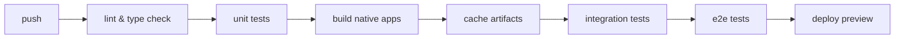

# native testing automation plan

## executive summary

this plan outlines the strategy to implement automated native testing for ios and android, leveraging patterns from existing projects (tamagui kitchen sink, chat app) and migrating to warp runners for improved mac ci capabilities.

## current state analysis

### existing test infrastructure references

#### 1. tamagui kitchen sink (production-ready)
- **location:** `~/tamagui/code/kitchen-sink/`
- **testing tools:**
  - maestro for declarative e2e testing (yaml-based)
  - vitest + webdriverio for programmatic ios testing
  - playwright for web e2e
- **key patterns:** component-based test organization, tag filtering

#### 2. chat app (production ci/cd)
- **location:** `~/chat/.github/workflows/`
- **ci provider:** currently testing warp runners
- **runner specs:** `[macOS, sequoia-xcode-beta]` (self-hosted) and `ghcr.io/cirruslabs/macos-runner:sequoia` (commented out)
- **build caching:** uses github actions cache with sha1 hash-based cache keys
- **workflow files:**
  - `build-ios-app.yml` - core ios build workflow (411 lines)
  - `build-ios-app-cached.yml` - wrapper with smart caching (211 lines)
  - `test-native-ios.yml` - native test setup (currently disabled, 83 lines)
  - `ios-cd.yml` - full cd pipeline with fastlane (321 lines)
- **key patterns:**
  - persistent derived data via `DERIVED_DATA_HOME` env var on self-hosted runners
  - xcode version pinning via `.xcode-version` file
  - separate native and js bundle builds for faster iteration
  - cache key based on file content hash (`.xcode-version`, `bun.lock`, `app.config.ts`, `assets/icon-app.png`)
  - appium not found (tests marked as TODO)

## proposed architecture

### phase 1: maestro integration (week 1-2)

maestro provides the easiest path to native testing with minimal setup complexity.

#### implementation steps

1. **install maestro cli**
```bash
curl -Ls "https://get.maestro.mobile.dev" | bash
```

2. **create test structure**
```
.maestro/
├── config.yaml           # maestro configuration
├── flows/
│   ├── smoke/           # smoke tests
│   │   ├── app-launch.yaml
│   │   └── auth-flow.yaml
│   ├── features/        # feature tests
│   │   ├── messaging.yaml
│   │   ├── profile.yaml
│   │   └── settings.yaml
│   └── regression/      # regression tests
└── helpers/             # reusable flows
    └── login.yaml
```

3. **add to package.json**
```json
{
  "scripts": {
    "test:native": "maestro test .maestro/",
    "test:ios": "maestro test .maestro/ --platform ios",
    "test:android": "maestro test .maestro/ --platform android",
    "test:native:smoke": "maestro test .maestro/flows/smoke/",
    "test:native:record": "maestro studio"
  }
}
```

4. **example test flow**
```yaml
# .maestro/flows/smoke/app-launch.yaml
appId: com.yourapp.dev
tags:
  - smoke
  - critical
---
- launchApp
- assertVisible:
    text: "Welcome"
- tapOn:
    id: "login-button"
- assertVisible:
    text: "Sign In"
```

### phase 2: warp runner migration (week 2-3)

warp provides macos runners with better performance and cost efficiency than github-hosted runners.

#### warp runner benefits
- **native mac support:** m1/m2 mac minis
- **faster builds:** 2-3x faster than github runners
- **cost effective:** ~40% cheaper for ios builds
- **simulator preloading:** ios simulators pre-installed
- **better caching:** persistent ssd caching

#### migration strategy

1. **register with warp**
   - sign up at https://www.warp.dev
   - configure organization and billing
   - obtain runner tokens

2. **update github workflows**
```yaml
# .github/workflows/test-native.yml
name: native tests

on:
  push:
    branches: [main]
  pull_request:

jobs:
  test-ios:
    runs-on: warp-macos-14-arm64  # warp runner
    steps:
      - uses: actions/checkout@v4

      - name: setup environment
        uses: ./.github/actions/setup-native

      - name: install maestro
        run: |
          curl -Ls "https://get.maestro.mobile.dev" | bash
          echo "$HOME/.maestro/bin" >> $GITHUB_PATH

      - name: build ios app
        run: bun run build:ios --configuration=Debug

      - name: run maestro tests
        run: maestro test .maestro/ --platform ios
```

3. **implement caching strategy**
```yaml
- name: cache ios build
  uses: actions/cache@v4
  with:
    path: |
      ios/build
      ~/Library/Developer/Xcode/DerivedData
    key: ios-build-${{ hashFiles('ios/Podfile.lock') }}-${{ hashFiles('**/*.swift') }}
    restore-keys: |
      ios-build-${{ hashFiles('ios/Podfile.lock') }}-
      ios-build-
```

### phase 3: appium integration (week 3-4)

for more complex testing scenarios requiring programmatic control.

#### setup appium with webdriverio

1. **install dependencies**
```bash
bun add -D @wdio/cli @wdio/local-runner @wdio/mocha-framework @wdio/appium-service appium appium-xcuitest-driver appium-uiautomator2-driver
```

2. **configure wdio**
```js
// wdio.conf.ios.js
export default {
  runner: 'local',
  specs: ['./tests/native/**/*.spec.js'],
  capabilities: [{
    platformName: 'iOS',
    'appium:deviceName': 'iPhone 15 Pro',
    'appium:platformVersion': '17.0',
    'appium:automationName': 'XCUITest',
    'appium:app': './ios/build/YourApp.app',
  }],
  services: ['appium'],
  framework: 'mocha',
  mochaOpts: {
    timeout: 60000
  }
}
```

3. **example test**
```js
// tests/native/login.spec.js
describe('login flow', () => {
  it('should login successfully', async () => {
    const loginButton = await $('~login-button')
    await loginButton.click()

    const emailField = await $('~email-input')
    await emailField.setValue('test@example.com')

    const passwordField = await $('~password-input')
    await passwordField.setValue('password123')

    const submitButton = await $('~submit-button')
    await submitButton.click()

    const welcomeText = await $('~welcome-message')
    await expect(welcomeText).toBeDisplayed()
  })
})
```

## testing strategy

### test pyramid

1. **unit tests (70%)**
   - component logic
   - business rules
   - data transformations
   - use vitest for js/ts

2. **integration tests (20%)**
   - api interactions
   - database operations
   - auth flows
   - use vitest + msw

3. **e2e tests (10%)**
   - critical user journeys
   - smoke tests
   - regression tests
   - use maestro/appium

### test environments

| environment | purpose | triggers |
|------------|---------|----------|
| development | rapid iteration | on commit to feature branch |
| staging | full test suite | on pr to main |
| production | smoke tests only | post-deployment |

### device matrix

#### ios coverage
- iphone 15 pro (primary)
- iphone 14
- iphone se (small screen)
- ipad pro (tablet)

#### android coverage
- pixel 8 (primary)
- samsung galaxy s24
- pixel 6a (mid-range)
- pixel tablet

## ci/cd pipeline

### workflow structure



### parallel execution strategy

```yaml
jobs:
  test-matrix:
    strategy:
      matrix:
        platform: [ios, android]
        device: [phone, tablet]
    runs-on: ${{ matrix.platform == 'ios' && 'warp-macos-14-arm64' || 'ubuntu-latest' }}
    steps:
      - name: run tests
        run: |
          maestro test .maestro/ \
            --platform ${{ matrix.platform }} \
            --device-type ${{ matrix.device }}
```

## performance targets

### build times
- ios debug build: < 5 minutes
- android debug build: < 3 minutes
- test execution: < 10 minutes per platform

### test reliability
- flakiness rate: < 2%
- retry mechanism: max 2 retries
- failure tracking: integrate with linear/github issues

### cost optimization
- use warp runners for ios (40% savings)
- use github runners for android
- implement smart caching
- run full suite only on main/release branches

## monitoring & reporting

### test analytics
- track test execution times
- monitor flaky tests
- coverage reports
- performance regression detection

### integration points
- maestro cloud for test history
- datadog/sentry for error tracking
- slack notifications for failures
- github status checks

## implementation plan for takeout3

based on chat's proven patterns, here's the concrete implementation path:

### step 1: copy chat's build infrastructure (day 1-2)

**actions:**
1. copy `~/chat/.github/workflows/build-ios-app.yml` to `.github/workflows/build-ios-app.yml`
2. copy `~/chat/.github/workflows/build-ios-app-cached.yml` to `.github/workflows/build-ios-app-cached.yml`
3. create `.github/actions/install` for dependency setup
4. create `.xcode-version` file (copy from chat or use `16.2` for sequoia)

**adaptations needed:**
```yaml
# update environment variables for takeout3
env:
  app_project_path: ./
  ios_app_name: takeout  # change from "Start"
  app_id: ios-takeout-app  # unique identifier
  prebuild_command: bun run prebuild:native --platform ios --no-install
  package_lock_file: bun.lock
  build_dir_path: ci_build
```

**file hash inputs:**
```yaml
file_paths_for_hash:
  .xcode-version
  bun.lock
  app.config.ts
  # add any other files that affect native build
```

### step 2: setup warp runners (day 2-3)

**runner configuration:**
1. use existing warp setup from chat
2. ensure runners have label: `[macOS, sequoia-xcode-beta]`
3. set `DERIVED_DATA_HOME` environment variable on runners for persistent caching

**verify runner setup:**
```yaml
jobs:
  verify:
    runs-on: [macOS, sequoia-xcode-beta]
    steps:
      - run: xcodes installed
      - run: echo "DERIVED_DATA_HOME=$DERIVED_DATA_HOME"
```

### step 3: add maestro testing (day 3-5)

**copy test workflow template:**
```yaml
# .github/workflows/test-native-ios.yml
name: iOS Native Tests
env:
  simulator_ios_version: 18
  simulator_device_name: iPhone 16 Pro

on:
  pull_request:
  push:
    branches: [main]

jobs:
  build-ios-app-dev:
    uses: ./.github/workflows/build-ios-app-cached.yml
    with:
      configuration: Debug
      destination: iOS-Simulator
      type: build

  test-ios-native:
    needs: build-ios-app-dev
    runs-on: [macOS, sequoia-xcode-beta]
    steps:
      - uses: actions/checkout@v4

      - name: Install Dependencies
        uses: ./.github/actions/install

      - name: Download Built App
        uses: actions/cache/restore@v4
        with:
          fail-on-cache-miss: true
          key: ${{ needs.build-ios-app-dev.outputs.output-cache-key }}
          path: ${{ needs.build-ios-app-dev.outputs.built-app-path }}

      - name: Install Maestro
        run: |
          curl -Ls "https://get.maestro.mobile.dev" | bash
          echo "$HOME/.maestro/bin" >> $GITHUB_PATH

      - name: Boot Simulator
        run: |
          xcrun simctl boot "${{ env.simulator_device_name }}" || true
          xcrun simctl list devices | grep Booted

      - name: Install App on Simulator
        run: |
          xcrun simctl install booted "${{ needs.build-ios-app-dev.outputs.built-app-path }}"

      - name: Run Maestro Tests
        run: |
          maestro test .maestro/ \
            --format junit \
            --output test-results.xml

      - name: Upload Test Results
        if: always()
        uses: actions/upload-artifact@v4
        with:
          name: maestro-test-results
          path: test-results.xml
```

**create initial maestro tests:**
```yaml
# .maestro/smoke/app-launch.yaml
appId: com.takeout.app  # update to your bundle id
tags:
  - smoke
---
- launchApp
- assertVisible: ".*"  # basic smoke test that app launches
```

### step 4: integrate with existing ci (day 5-7)

**update main ci workflow:**
```yaml
# in existing .github/workflows/ci.yml
jobs:
  # existing jobs...

  test-native-ios:
    if: github.event_name == 'pull_request'
    uses: ./.github/workflows/test-native-ios.yml
    secrets: inherit
```

**add package.json scripts:**
```json
{
  "scripts": {
    "test:native": "maestro test .maestro/",
    "test:native:ios": "maestro test .maestro/ --platform ios",
    "test:native:smoke": "maestro test .maestro/smoke/",
    "build:ios": "bun run prebuild:native --platform ios && cd ios && pod install",
    "build:ios:debug": "npm run build:ios -- --configuration Debug"
  }
}
```

### step 5: optional cd pipeline (week 2+)

**if you need testflight uploads:**
1. copy `~/chat/.github/workflows/ios-cd.yml` to `.github/workflows/ios-cd.yml`
2. setup fastlane match for code signing
3. add github secrets:
   - `APPLE_CODE_SIGNING_GIT_URL`
   - `APPLE_CODE_SIGNING_GIT_SSH_KEY`
   - `APPLE_CODE_SIGNING_GIT_PASSPHRASE`
   - `APP_STORE_CONNECT_API_KEY_ISSUER_ID`
   - `APP_STORE_CONNECT_API_KEY_ID`
   - `APP_STORE_CONNECT_API_KEY_P8`

## implementation timeline

### week 1-2: foundation
- [x] copy chat build workflows
- [x] adapt for takeout3 configuration
- [ ] verify warp runners working
- [ ] install maestro locally
- [ ] write first 5 smoke tests
- [ ] setup local test execution
- [ ] document test writing guidelines

### week 2-3: ci integration
- [ ] enable test workflow on prs
- [ ] implement caching strategy
- [ ] setup pr status checks
- [ ] add test result reporting
- [ ] optimize build times

### week 3-4: expansion
- [ ] expand test coverage to 20+ tests
- [ ] add feature-specific test flows
- [ ] implement device matrix testing
- [ ] setup nightly regression runs

### week 4+: optimization
- [ ] analyze and optimize slow tests
- [ ] implement parallel execution
- [ ] add performance testing
- [ ] setup monitoring dashboard
- [ ] optional: setup cd pipeline for testflight

## success metrics

### short term (1 month)
- 20+ automated test cases
- < 10 minute test execution
- 95% test pass rate
- zero manual testing for smoke tests

### medium term (3 months)
- 50+ test cases across platforms
- full device matrix coverage
- automated release testing
- 50% reduction in bug escape rate

### long term (6 months)
- 100+ comprehensive test suite
- < 5% flakiness rate
- full ci/cd automation
- 80% reduction in manual testing effort

## risks & mitigations

| risk | impact | mitigation |
|------|--------|------------|
| warp runner availability | high | maintain github runner fallback |
| test flakiness | medium | implement retry logic, investigate root causes |
| maintenance overhead | medium | establish test ownership, regular cleanup |
| slow feedback loop | high | parallelize tests, optimize build times |

## cost analysis

### current state
- github runners: ~$800/month
- manual testing: 20 hours/week

### projected with warp
- warp runners: ~$480/month
- automated testing: 5 hours/week maintenance
- roi: 6 weeks

## appendix

### useful resources
- [maestro documentation](https://maestro.mobile.dev/docs)
- [warp runner setup](https://docs.warp.dev/runners)
- [appium best practices](https://appium.io/docs/en/latest/)
- [github actions optimization](https://docs.github.com/actions/optimization)

### example configurations
- see `~/tamagui/code/kitchen-sink/.maestro/` for production maestro examples
- see `~/chat/.github/workflows/` for warp runner configuration

### detailed chat workflow references

the chat project has production-ready workflows we can adapt:

#### 1. core build workflow (`~/chat/.github/workflows/build-ios-app.yml`)

**key features:**
- runs on: `[macOS, sequoia-xcode-beta]` (self-hosted warp runners)
- supports both simulator and device builds
- implements smart caching with `output-cache-key` pattern
- uses persistent `DERIVED_DATA_HOME` on self-hosted runners for speed
- xcode version management via `xcodes` cli
- separate prebuild and pod install steps
- configurable build vs archive mode
- uploads artifacts and build logs

**environment variables:**
```yaml
app_project_path: ./
ios_app_name: Start
app_id: ios-rn-app
prebuild_command: bun run prebuild:native --platform ios --no-install
package_lock_file: bun.lock
build_dir_path: ci_build
```

**critical steps:**
1. checkout
2. select xcode version from `.xcode-version` file
3. install dependencies via custom action `./.github/actions/install`
4. write public env to `.env`
5. prebuild (expo prebuild without pod install)
6. pod install
7. xcodebuild with custom derived data path
8. cache built app for downstream jobs

**caching strategy:**
- checks for cached output before building
- uses `actions/cache/restore` with `lookup-only: true` for fast checks
- saves to cache with `actions/cache/save` after successful build
- persistent derived data on self-hosted runners via `DERIVED_DATA_HOME`

#### 2. cached build wrapper (`~/chat/.github/workflows/build-ios-app-cached.yml`)

**innovation:** splits native and js builds for faster iteration

**architecture:**
- job 1: calculate cache key based on file hashes
- job 2: build native app (calls `build-ios-app.yml`)
- job 3: build js bundle and inject into cached native app

**cache key calculation:**
```bash
# files that affect native build
file_paths_for_hash:
  - .xcode-version
  - bun.lock
  - app.config.ts
  - assets/icon-app.png

# sha1 hash of concatenated file contents
hash=$(echo "$FILES" | xargs cat | sha1sum | awk '{print $1}')
cache_key="${app_id}-${destination}-${configuration}-${type}-${hash}"
```

**js bundle injection:**
- downloads cached native build
- runs react native bundle script
- injects into `.app` bundle
- uploads final artifact

**speedup:** if native dependencies unchanged, only rebuilds js (seconds vs minutes)

#### 3. native test workflow (`~/chat/.github/workflows/test-native-ios.yml`)

**status:** disabled but shows intended architecture

**pattern:**
```yaml
jobs:
  build-ios-app-dev:
    uses: ./.github/workflows/build-ios-app.yml
    with:
      configuration: Debug

  test-ios-native-dev:
    needs: build-ios-app-dev
    runs-on: [macOS, sequoia-xcode-beta]
    steps:
      - checkout
      - install dependencies
      - download built app from cache
      - # TODO: run tests here
```

**simulator configuration:**
```yaml
env:
  simulator_ios_version: 18
  simulator_device_name: iPhone 16 Pro
```

**trigger:** disabled via impossible branch name
```yaml
on:
  push:
    branches:
      - this-workflow-is-disabled-for-now
```

#### 4. cd pipeline (`~/chat/.github/workflows/ios-cd.yml`)

**full production deployment workflow**

**triggers:**
- main branch pushes
- pull requests with commit message containing `native:`

**jobs:**
1. **archive-ios-app** - builds release archive
2. **generate-changelog** - creates release notes
3. **sign-and-upload** - signs and uploads to testflight

**key techniques:**

**temporary keychain management:**
```bash
keychain_name="temp-$(openssl rand -hex 6)"
security create-keychain -p "$keychain_password" "$keychain_name"
security set-keychain-settings -t 3600 -l "$keychain_name"
```

**fastlane code signing:**
```bash
fastlane match run \
  --type appstore \
  --readonly \
  --git_url "$APPLE_CODE_SIGNING_GIT_URL" \
  --git_private_key "$APPLE_CODE_SIGNING_GIT_SSH_KEY" \
  --keychain_name "$KEYCHAIN_NAME"
```

**build number management:**
```bash
# fetch latest testflight build number
fastlane run latest_testflight_build_number \
  app_identifier:"$APP_BUNDLE_ID" \
  version:"$APP_VERSION"

# increment for new build
next_build_number=$(( 10#$latest_build_number + 2 ))
```

**plist manipulation:**
```bash
/usr/libexec/PlistBuddy -c "Set :CFBundleVersion $BUILD_NUMBER" "$BUILT_APP_PATH/Info.plist"
```

**export and upload:**
```bash
xcodebuild -exportArchive \
  -archivePath "$BUILT_ARCHIVE_PATH" \
  -exportOptionsPlist export.plist \
  -exportPath _export

fastlane pilot upload --ipa "$IPA_PATH" \
  --skip_submission true \
  --changelog "$CHANGELOG"
```

#### 5. reusable patterns

**custom github action for install (`~/chat/.github/actions/install`):**
- centralizes dependency installation
- used across all workflows
- ensures consistency

**xcode version management:**
```bash
# list installed xcodes
xcodes installed

# select from .xcode-version file
xcodes select "$(cat .xcode-version)"
```

**derived data optimization:**
```bash
# on self-hosted runners, use persistent location
if [ -n "$DERIVED_DATA_HOME" ]; then
  derived_data_path="$DERIVED_DATA_HOME/$GITHUB_REPO"
fi
```

**conditional caching:**
```yaml
- if: ${{ !steps.check-cached-output.outputs.cache-hit }}
  run: # expensive operation
```

### contact points
- warp support: support@warp.dev
- maestro community: discord.gg/maestro
- internal: #native-testing slack channel